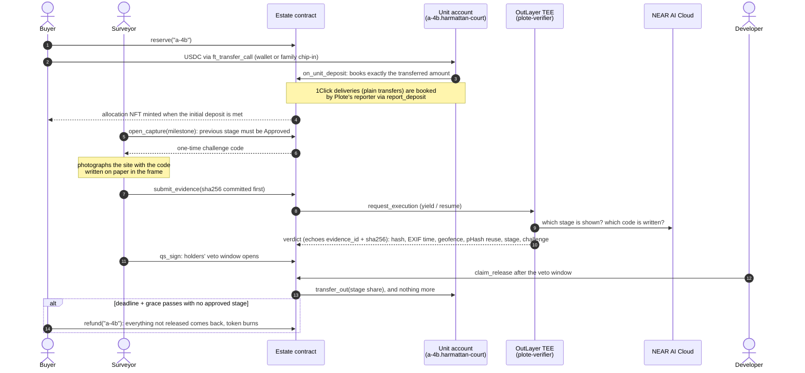
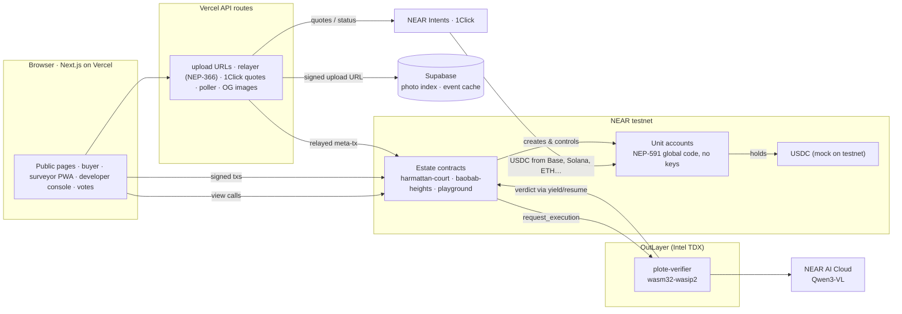

<div align="center">

# Plote

### Pay for the house you can see.

**Off-plan escrow on NEAR, where every housing unit is its own account and the NFT is the key to it.**

[](#why-this-is-an-nft-that-does-something)
[](#live-deployment)
[](LICENSE)

[**Live app**](https://plote-vert.vercel.app) · [**Build spec**](docs/SPEC.md) · [**Contract interface**](docs/INTERFACE.md) · [**Demo script**](docs/demo-script.md)

</div>

---

## The problem

Buying a flat "off-plan", before it is built, is how most new homes in Lagos and Abuja are sold. Buyers pay in instalments over 12 to 24 months, and three problems keep repeating:

| | What happens | Why it hurts |
|---|---|---|
| **Sold twice** | The same unit is sold to more than one buyer. | You find out at handover, years later. |
| **Paid up front, built never** | Instalments go straight to the developer's account. | When a project stalls, the money is already spent. |
| **Photos from far away** | Diaspora buyers, who drive a large share of sales, judge progress from WhatsApp pictures. | Those photos can be from anywhere, or from last year. |

Sources: [TechEconomy](https://techeconomy.ng/?p=164669) · [Nigeria Housing Market](https://www.nigeriahousingmarket.com/news/20-real-estate-scams-nigerian-property-buyers-must-avoid) · [allAfrica](https://allafrica.com/stories/202601290263.html) · [Guardian Nigeria](https://guardian.ng/property/diasporan-investors-drive-growth-expose-fault-lines-in-real-estate-sector/) · [Nation (Kenya)](https://nation.africa/kenya/news/off-plan-scams-from-dream-homes-to-dust--5347430)

## The solution

Plote gives **every off-plan unit its own NEAR account**, for example `a-4b.harmattan-court.plote.testnet`.

- **The buyer pays the unit, not the developer.** The USDC sits in the unit's account, which has no keys and obeys only its estate contract.
- **Money moves only on proof.** Each construction stage releases its share (20 / 30 / 30 / 20 %) only after a site photo passes checks inside secure hardware and a quantity surveyor signs.
- **If the build stalls, the buyer takes the money back.** After a missed deadline, whoever holds the unit's token pulls back everything not yet released. Nobody has to approve it.
- **Anyone can check any unit in seconds.** Type a unit name into `/check` to see who holds it, what has been paid, what has been released and what has been proven. No login.

> Demo estates (Harmattan Court, Baobab Heights, Plote Playground) and every person in them are fictional.

---

## Contents

- [Why this is an NFT that does something](#why-this-is-an-nft-that-does-something)
- [How it works](#how-it-works)
- [Architecture](#architecture)
- [Live deployment](#live-deployment)
- [Try it](#try-it)
- [Security model](#security-model)
- [Trust assumptions and what is still open](#trust-assumptions-and-what-is-still-open)
- [Repository layout](#repository-layout)
- [Run it yourself](#run-it-yourself)
- [Testing and quality](#testing-and-quality)
- [Tech stack](#tech-stack)
- [Spec conformance](#spec-conformance)
- [Honest limits](#honest-limits)
- [Roadmap](#roadmap)
- [Licence and credits](#licence-and-credits)

---

## Why this is an NFT that does something

The allocation NFT (NEP-171 / 177 / 178 / 181) **is not a picture of a house. It is the right to one unit's account.** Its token ID is the unit ID, so each unit can only ever have one token, and a second sale of the same unit fails with `E_UNIT_TAKEN`. Every right below is enforced by the contract against whoever holds the token:

| The token… | Enforced by |
|---|---|
| **Holds the money.** Payments sit in the unit's own account until a stage is proven. | Unit account + `on_unit_deposit` |
| **Pulls a refund.** After a deadline plus grace with no approved stage, the holder takes back everything not released. | `refund(unit_id)`, holder only |
| **Sells in one step.** The buyer's USDC and the token swap in a single transaction, and the escrow stays with the unit. | `list_for_sale` → `ft_transfer_call` |
| **Protects you if you fall behind.** Missed instalments list the unit for what you paid, minus a fixed 5 %. Nothing is forfeited. | `declare_default` |
| **Votes.** Each token votes with its net equity, `min(paid − refunded, price)`, never more than it weighed when the proposal opened. Every kind but Veto also needs a majority of distinct holders and a quorum. Tokens bought or topped up after a vote opens can't swing it. Used to replace the surveyor, veto a sign-off, freeze releases or extend a deadline. | `propose` / `vote` |
| **Opens the gate.** After handover, the holder signs a gate pass that the guard's phone checks against the chain. | NEP-413 signed message |

The token's **image is drawn by the contract** from the unit's live state on every view. Each proven stage fills in, and the windows turn gold at handover, so the NFT always shows what it's worth.

---

## How it works



**Nothing is booked from a balance read alone.** Money can arrive two ways ([INTERFACE §1.2.1](docs/INTERFACE.md)):

- **Wallet payments** (`ft_transfer_call`, including a relative's chip-in) are booked by `on_unit_deposit` for exactly the transferred amount, once. A payment to a unit that isn't reserved or held, or while a transfer out is pending, is refused and USDC returns it.
- **Cross-chain deliveries** (NEAR Intents 1Click, a plain `ft_transfer`) are booked only when Plote's deposit reporter calls `report_deposit`. The estate reads the unit's balance twice and credits at most the surplus seen in both reads and at most the amount reported. This reporter is a trusted Plote account (see [Trust assumptions](#trust-assumptions-and-what-is-still-open)).

USDC that nobody reported can be booked as `unattributed` (never as anyone's payment) by the developer, through a request, a 7-day wait and a finalize step, and then swept. Public `sync` only reports the balance; it credits nothing.

---

## Architecture



| Component | Path | Role |
|---|---|---|
| **Estate contract** | `contracts/estate` | Units, allocation NFT, milestones, evidence and verdicts, releases, refunds, resale, default, holder votes, dynamic NFT image. |
| **Unit contract** | `contracts/unit` | Runs on every unit account, published once as a NEP-591 global contract. Holds the USDC, has no keys, and obeys only its estate. |
| **Mock USDC** | `contracts/musdc` | NEP-141 test token with an open faucet (testnet only). |
| **Verifier** | `verifier/` | OutLayer TEE worker: SHA-256 integrity, EXIF freshness, GPS geofence, perceptual-hash reuse, screen-photo detection, and NEAR AI stage plus challenge-code reading. |
| **Web app** | `web/` | Next.js App Router: public check, estates, units, proofs, the buyer flow, the surveyor PWA, the developer console, votes and the API routes. |
| **Scripts** | `scripts/` | Deploy and demo tooling, including wallet-free OutLayer setup (`outlayer-setup.ts`). |
| **Off-chain cache** | `supabase/` | Photo index, event feed cache, 1Click quotes, chip-ins. The chain stays the source of truth. |

---

## Live deployment

**App:** https://plote-vert.vercel.app · health: [`/api/health`](https://plote-vert.vercel.app/api/health)

| Piece | Account / location | Status |
|---|---|---|
| Judge sandbox estate | [`playground.plote.testnet`](https://testnet.nearblocks.io/address/playground.plote.testnet), 60 units at $1,000 | ✅ Live. Foundation Approved and its 20 % released for the two allocated units, `p-55` and `p-56` (see the proof below); roofing is the next open stage |
| Demo estate | [`harmattan-court.plote.testnet`](https://testnet.nearblocks.io/address/harmattan-court.plote.testnet), 6 units | ✅ Live. `a-4b` and `b-3b` allocated; all four milestones Open (no photo evidence yet) |
| Refund-demo estate | [`baobab-heights.plote.testnet`](https://testnet.nearblocks.io/address/baobab-heights.plote.testnet), 5 units, foundation deadline missed | ✅ Live. The judge wallet holds `b-2a`, `b-2b` and `b-2c`, refunds open |
| Estate code (all three estates) | NEAR `code_hash` `21YwLKPbLk6z4zPRS1gr9p553PW1Hb65CgiBRqJ9d3WF` (sha256 `0effcc46c6ed4c3b29f88872b6f6e076e4559af8e087b65be5c03df8f56bd6a8`), the reproducible build of commit `92fc822`. Upgraded in place with state intact, then `migrate` → `state_version` 2 | ✅ Reproducible: see [Reproducible build](#reproducible-build) |
| Unit code (global, by hash) | `75ddgBuGJQYJKgjiBkvZ6FVsMnGFfJvtYCrs3A6aFxb9` (105,621 B) | ✅ Published |
| Test USDC | [`musdc.plote.testnet`](https://testnet.nearblocks.io/address/musdc.plote.testnet) | ✅ Live |
| Verifier project | `plote.testnet/plote-verifier` on `outlayer.testnet` | ✅ Published |
| Verifier version (pinned on-chain) | `07cf962632350d40bcdc4318d382af8f31aa49aab264b7b725add86dd415df6b`, the hardened build, reproducible with `cd verifier && ./build-wasm.sh` | ✅ All three estates pinned (the two sold estates through `repin_verifier`, see [Security model](#security-model)) |
| Verifier binary | [FastFS](https://test.fastfs.io/plote.testnet/outlayer.testnet/07cf962632350d40bcdc4318d382af8f31aa49aab264b7b725add86dd415df6b.wasm) (anyone can re-hash it) | ✅ |
| Verifier secrets access | NEAR AI key stored as an OutLayer secret per estate with `Predecessor(Whitelist[estate])`: only runs requested by that estate contract can use it | ✅ All three estates |
| Live photo check | Playground evidence 6: capture code `2NJF8S` → upload → `submit_evidence` → OutLayer TEE (`plote-verifier@0.1.0`, NEAR AI `Qwen/Qwen3-VL-30B-A3B-Instruct`) → **Pass**, no reasons or warnings → surveyor sign-off → 2-minute veto window → `claim_release` on `p-55` and `p-56` released 20 USDC from each to `dev-harmattan.plote.testnet`. [Proof page](https://plote-vert.vercel.app/proof/playground/6). Read the [note on this test photo](#about-the-live-proof-photo) | ✅ First live end-to-end pass (12 Nov) |
| Off-chain cache | Supabase (12 tables across migrations 0001–0007, row-level security on all of them, `evidence` bucket) | ✅ Live (0001–0007 applied) |
| Gasless relayer | `relayer.plote.testnet` | ✅ Live |
| Mainnet any-chain payment (≈ $2) | One unit receiving USDC through 1Click | ⏳ Pending |

Every number on the live site is read from the chain. Until a figure exists it shows "—" rather than a made-up value.

### About the live proof photo

The photo behind evidence 6 is a public-domain 1943 photograph of a building foundation. The one-time code was written
on paper, composited into the image digitally, and EXIF was stamped onto the file. The model accepted it. This is the
documented limit of the challenge code: reading the code in the frame shows the photo was made after the capture
opened, but it cannot prove the paper was physically on a site. The playground has no geofence. Non-demo estates (every mainnet
estate) require the phone's GPS (`gps_device_missing` otherwise), cross-checked against EXIF GPS and the geofence; the
surveyor's signature and the holders' veto remain the backstop. See [Trust assumptions](#trust-assumptions-and-what-is-still-open).

---

## Try it

**No install, NEAR testnet.** Use any NEAR testnet wallet (Meteor, MyNearWallet, HOT, Intear and others).

1. **Check a unit.** Open [`/check`](https://plote-vert.vercel.app/check) and type `a-4b.harmattan-court` or `p-55.playground` to see the holder, payments, releases and status.
2. **Read a passed proof.** [`/proof/playground/6`](https://plote-vert.vercel.app/proof/playground/6) shows every check, the photo, the model's observations, the model name, the pinned worker version and the raw verdict of the first live pass (read the [note on that photo](#about-the-live-proof-photo)).
3. **Get test money.** Connect a wallet, open [`/faucet`](https://plote-vert.vercel.app/faucet) and mint 5,000 test USDC.
4. **Buy a unit.** In the [Plote Playground](https://plote-vert.vercel.app/estates/playground), pick any available unit (`p-01`…`p-60`), **Reserve**, then **Pay** at least 10 %. The allocation NFT mints to you; `/me` shows it, and the unit account's balance is on NearBlocks.
5. **Prove a stage** (on the playground any wallet may act as surveyor; open [`/qs`](https://plote-vert.vercel.app/qs) and pick the playground):
   1. **Capture** opens a capture for the next open stage (stages go in order; foundation is already Approved, so this is roofing) and shows a 6-character code. Write it on paper. If another wallet already holds an open capture for that stage, the page says until when (at most 30 minutes).
   2. Photograph the paper with your phone's camera *after* the code appeared. The photo needs its EXIF capture time and a short side of at least 800 px; a photo of a screen fails. The playground has no geofence and treats a stage mismatch as a warning, so the paper can be anywhere. Each account can submit at most 5 photos an hour.
   3. Watch the TEE verdict land on-chain, then open its proof page. If NEAR AI or the worker was unreachable, the evidence is marked Error, the 0.05 NEAR check fee goes back to the estate's budget and the stage reopens: capture again.
   4. **Sign** the passed stage, wait for the 2-minute veto window, then **Claim releases** on [`/dev/estates/playground/releases`](https://plote-vert.vercel.app/dev/estates/playground/releases) (anyone may call `claim_release`; the money always goes to the estate's payout account).

   Each unit releases the approved stages' share of what it has paid (capped at its price): 20 % for foundation, 50 % once roofing is approved. Nothing more.
6. **Refund** (Baobab Heights): units past their deadline show **Get my money back**. One tap and everything not released returns to the holder, and the token burns. The judge wallet holds `b-2a`, `b-2b` and `b-2c` for this.

The full narrated flow is in [`docs/demo-script.md`](docs/demo-script.md). Shared judge-wallet credentials are provided with the submission, not in this repository.

---

## Security model

| Boundary | Guarantee | How |
|---|---|---|
| **Funds** | Only the estate's public rules can move USDC. | Unit accounts are created with no access keys; `transfer_out` accepts calls from the estate only (`E_NOT_ESTATE`). The estate's own code can still be replaced by whoever holds its full-access key on testnet (see [still open](#trust-assumptions-and-what-is-still-open)). |
| **One unit, one owner** | A unit can't be sold twice. | Token ID = unit ID; a second mint panics with `E_UNIT_TAKEN`. |
| **Stage order** | Money for a later stage can't be released before the earlier ones. | `open_capture`, `submit_evidence` and `qs_sign` for milestone *i* need milestone *i − 1* Approved (`E_MILESTONE_STATE`); releases count approved stages in order only. `handover` needs every milestone Approved. |
| **Photo integrity** | The checked photo is the uploaded photo. | Its SHA-256 is committed on-chain *before* the verifier runs, and the verdict must echo that `evidence_id` and `sha256` (else it fails as `verdict_unbound`, or `E_VERDICT_MISMATCH` for HTTPS-mode `submit_verdict`). |
| **Verdict provenance** | Verdicts come only from the pinned worker. | Estates in `outlayer` mode reject relayer verdicts (`E_VERIFY_MODE`). Each estate is pinned to an OutLayer version key (the WASM's SHA-256). Outside the playground, new estates refuse an `outlayer_id` other than `outlayer.testnet` / `outlayer.near`, and `playground: true` is refused on non-`.testnet` accounts. Any `mock*` warning becomes a failing reason. For an estate pinned to a GitHub source instead of an OutLayer project, a verdict whose `worker_commit` differs from the pin is stored as Error; the live estates use the OutLayer project pin. |
| **Verifier pin changes** | A sold estate's verifier can't be swapped by the developer. | `set_verifier` (1 yocto) only before the first sale. `repin_verifier` works after sales but only from the estate account itself, which already holds the power to redeploy the code; it can't go back to the pre-hardening build, and it disappears when the estate's keys are deleted at launch. |
| **Freshness** | The photo was made after the capture opened. | A one-time challenge code must be readable in the frame and EXIF time must not predate the capture. This check fails hard in every mode. It does not prove the paper was physically on site. |
| **Location** | Outside the playground, the photo's position is checked. | New non-playground estates must have a geofence (50–2,000 m). The position (EXIF GPS, else the phone's GPS) must be inside it, and when both are present they must agree within 100 m. On non-demo estates (every mainnet estate, since mainnet refuses `demo_mode`) the phone's GPS is required (`gps_device_missing`); on the testnet demo estates its absence is a warning. The playground has no geofence. |
| **Votes** | Late money and sybil splits can't capture a vote. | Weight = net equity `min(paid − refunded_out, price)`, capped at the weight when the proposal opened; every kind but Veto also needs a majority of distinct holders and a quorum (≥ 3 tokens, ≥ 25 % of units). |
| **Liens** | A holder can't saddle a lender (or escape a default) unilaterally. | `set_lien` only offers; the lender must `accept_lien`. Default sales and lien-first refunds pay the lender first, up to its cap. |
| **Surveyor power** | The surveyor can't move money. | Their scoped key can only call milestone methods. Holders can veto a sign-off or vote the surveyor out. |
| **Relayer** | The relayer pays gas for surveyor calls and nothing else. | An allowlist of methods (`open_capture`, `submit_evidence`, `qs_sign`) and receivers, a zero deposit, a gas cap, signature/nonce/expiry checks before submitting, and per-estate rate limits. |
| **Deposit reporter** | Trusted, but bounded. | Each estate's `verdict_relayer` books 1Click plain transfers with `report_deposit`. It can credit at most the surplus seen in two balance reads and at most what it attests; it cannot create money that never reached the unit. The server signs as it with a separate `REPORTER_*` key (required on mainnet); the testnet estates still name `relayer.plote.testnet` as `verdict_relayer`, so on testnet the relayer and reporter are one account. |
| **Secrets** | The NEAR AI key is usable only by Plote's estates. | Encrypted to the OutLayer keystore, stored per estate and whitelisted to that estate account. |

### Verifier checks, in order (fail fast)

| # | Check | Fails when (reason code) | Playground |
|---|---|---|---|
| 0 | Input | bad input, a bad geofence, or a photo URL outside the allowed storage prefix (`bad_input`, `bad_geofence`, `url_not_allowed`) | fail |
| 1 | Integrity | the photo can't be fetched (no redirects are followed) (`fetch_failed`), or its SHA-256 ≠ the hash committed on-chain (`hash_mismatch`) | fail |
| 2 | Decode | the image is unreadable, too small or too large (`bad_image`, `image_too_large`) | fail |
| 3 | Freshness | EXIF time is missing, in the future or too old (`exif_missing`, `exif_future`, `exif_stale`) | fail (max age one year) |
| 4 | Location | the phone's GPS is missing, GPS is missing, EXIF and phone GPS disagree, or the position is outside the geofence (`gps_device_missing`, `gps_missing`, `gps_mismatch`, `outside_geofence`) | skipped (no geofence) |
| 5 | Reuse | the perceptual hash, in any of 8 orientations, is too close to an earlier photo (`phash_reuse:<d>`) | fail |
| 6 | Stage (NEAR AI, model pinned and recorded as `ai_model`, one retry) | it's a photo of a screen or print (`ai_screen_photo`); the image contains instructions to the inspector (`ai_instruction_text`); the AI sees a different stage or is unsure (`ai_stage_mismatch`, `ai_low_confidence`); the AI is unreachable (`ai_unavailable`) | screen photo and instruction text fail; stage → warning |
| 7 | Challenge | the written code is unreadable, missing or wrong, or the photo predates the capture (`challenge_unverified`, `challenge_missing`, `challenge_mismatch`, `exif_before_capture`) | **fail, always** |

A verdict that fails only for infrastructure reasons (`ai_unavailable`, `worker_error`, or `challenge_unverified`
because the model was down) is stored as Error: the milestone reopens and the 0.05 NEAR check fee returns to the
estate's verification budget.

Panics use stable `E_*` codes ([INTERFACE §1.5](docs/INTERFACE.md)) that the app maps to plain-English messages ([`web/lib/errors.ts`](web/lib/errors.ts)).

---

## Trust assumptions and what is still open

Four rounds of internal review are recorded in [`docs/SECURITY-REVIEW.md`](docs/SECURITY-REVIEW.md). None of them is an
independent audit. After the fourth round these are still open:

1. **Estate keys on testnet.** Each estate account still holds a full-access key, so the key holder (Plote) can
   upgrade the estate's code, and with it change any rule above. The keys are deleted at mainnet launch
   ([LAUNCH.md §3](docs/LAUNCH.md)); `/status` shows each estate as "not locked" until then.
2. **No timelock on `StepIn` / `ReplaceSurveyor`.** A passing vote executes at once. The quorum, both majorities and
   the net-equity snapshot are the safeguards ([INTERFACE §1.2](docs/INTERFACE.md)).
3. **Veto stall.** A holder with at least half of the voting weight can stop a Veto from passing by abstaining (A3-6).
4. **Deposit reporter.** Plote's reporter account is trusted to report 1Click plain-transfer deposits honestly. It can
   credit at most the surplus seen in two balance reads, but a dishonest reporter could book money from a pending
   `ft_transfer_call` that is later refunded.
5. **The challenge code is not proof of presence.** It shows the photo was made after the capture opened. It cannot
   show the paper was physically on site: the live playground pass used a 1943 photograph with the code composited
   in ([note](#about-the-live-proof-photo)). GPS on non-demo estates, the surveyor's signature and the holders' veto
   are the other layers; device-attested capture (C2PA or platform attestation) is not built.
6. **CSP.** `script-src` still allows `'unsafe-inline'` and `'unsafe-eval'` because the wallet SDKs need them, so the
   CSP stops framing but not injected script.
7. **External gates:** an independent audit, a legal opinion in each launch market, and a mainnet pilot on a real site
   ([LAUNCH.md §1](docs/LAUNCH.md)).

---

## Repository layout

```
contracts/
  estate/            estate contract (near-sdk 5.29.1) and its unit tests (tests.rs)
  unit/              unit-account contract, published as a NEP-591 global contract
  musdc/             testnet USDC with an open faucet
  mocks/outlayer-mock/   canned verdicts for offline runs (marked "mock_verifier")
verifier/            OutLayer TEE worker (Rust, wasm32-wasip2) and fixtures
web/                 Next.js 16 app: pages, components, API routes, Vitest + Playwright tests
scripts/             near-api-js deploy and demo scripts, outlayer-setup.ts
config/              estate configs (pinned verifier, deadlines, units) and deployments.testnet.json
supabase/migrations/ off-chain cache schema with row-level security
tests/integration/   near-mock tests that run the real contract WASMs together
docs/                SPEC.md (design) · INTERFACE.md (exact JSON interface) · demo-script.md · hosting.md
```

---

## Run it yourself

### Prerequisites

- Rust stable with `wasm32-unknown-unknown` and `wasm32-wasip2`, plus `cargo-near` 0.22
- Node 22 and pnpm 10
- `just`
- A funded NEAR testnet account (see the budget below)

### Build and test

```bash
git clone https://github.com/linoxbt/Plote && cd Plote
just test          # contracts, web unit tests and verifier
just build         # contract WASMs into target/near/
just lint          # fmt, clippy -D warnings, eslint, typecheck
just test-integration
```

### Deploy to testnet

```bash
pnpm -C scripts install
# Put the root account key in ~/.near-credentials/testnet/plote.testnet.json (never in the repo)
just accounts      # developer, surveyor, relayer, buyers and judge accounts
just deploy-testnet
(cd verifier && ./build-wasm.sh)   # reproducible verifier WASM; prints its SHA-256 (the OutLayer version key)
NEAR_AI_API_KEY=… pnpm -C scripts exec tsx outlayer-setup.ts   # publish, store secret, pin (or repin) estates
just seed          # demo purchases and proofs (see docs/SPEC.md §13.9)
```

`outlayer-setup.ts` needs no wallet or dashboard. It does what the official `outlayer-cli` does:
1. Uploads the verifier to FastFS.
2. Creates the OutLayer project.
3. Encrypts the NEAR AI key to the OutLayer keystore and stores it for each estate.
4. Pins each estate to the version key, which is the SHA-256 of the WASM: `set_verifier` on an estate with no sales,
   `repin_verifier` signed by the estate account's own key on an estate that already has sales.

### NEAR budget (measured on testnet)

| Item | Cost |
|---|---|
| Unit code published once as a global contract (105.6 KB; global deploys burn 10 NEAR per 100 KB) | **10.56 NEAR, burned** |
| Each estate account (≈ 682 KB contract ≈ 6.7 NEAR of storage, plus headroom) | about 8 NEAR |
| Verification budget per estate (0.05 NEAR per photo check) | 2 NEAR |
| Units | 0.035 NEAR each |
| Role accounts (developer, surveyor, relayer, 4 buyers, judge) | 16.5 NEAR |
| Mock USDC | 2.5 NEAR |
| OutLayer project and each estate's secret | 0.1 NEAR each |

All three estates with seed data come to a little over 70 testnet NEAR.

### Web app

```bash
cp web/.env.example web/.env.local
just web
```

| Variable | Where | Purpose |
|---|---|---|
| `NEXT_PUBLIC_NETWORK`, `NEXT_PUBLIC_RPC_URL`, `NEXT_PUBLIC_ESTATES`, `NEXT_PUBLIC_USDC_ID`, `NEXT_PUBLIC_APP_URL` … | public | network, RPC, estates shown, token, the app's https URL (never localhost in production) |
| `NEXT_PUBLIC_ESTATE_CODE_HASHES` | public, optional | comma-separated base58 code hashes of genuine estate builds. An account is treated as a Plote estate only if it is in `NEXT_PUBLIC_ESTATES`, or is a subaccount of `NEXT_PUBLIC_ROOT_ACCOUNT` whose `code_hash` is in this list. Default: `21YwLKPb…` and `J31YPbxD…` |
| `NEXT_PUBLIC_SUPABASE_URL`, `NEXT_PUBLIC_SUPABASE_ANON_KEY` | public | read-only cache (row-level security allows select on public tables only) |
| `SUPABASE_SERVICE_ROLE_KEY` | **server only** | signed photo upload URLs, poller writes |
| `RELAYER_ACCOUNT_ID`, `RELAYER_PRIVATE_KEY` | **server only** | gasless meta-transactions (NEP-366) for surveyor calls |
| `REPORTER_ACCOUNT_ID`, `REPORTER_PRIVATE_KEY` | **server only** | the estates' `verdict_relayer`: signs `report_deposit` and `submit_verdict`. Keep it separate from the relayer; required on mainnet, testnet falls back to the relayer key |
| `CRON_SECRET` | **server only** | manual poller runs and the detailed health view |
| `POLL_SECRET` | **server only** | the Supabase pg_cron call to the 5-minute poller (same value as Vault `plote_poll_secret`) |
| `NOTIFY_SECRET` | **server only** | signs email confirm/unsubscribe links; required for emails (no signing fallback) |
| `RESEND_API_KEY` + `RESEND_FROM` | server, optional | milestone emails; both required, sender on a Resend-verified domain |
| `ALERT_WEBHOOK_URL`, `NEARBLOCKS_API_KEY` | server, optional | poller alerts; the poller's receipt listing |
| `ONECLICK_JWT` | server, optional | removes the 1Click fee (mainnet build) |

Every variable has a testnet default, so the app builds and renders with no env at all. A feature that needs a missing secret returns a clear 503. The full list, and the database migrations to apply in order (`0001`–`0007`), are in [`docs/hosting.md`](docs/hosting.md).

### Reproducible build

`cargo near build reproducible-wasm` builds the estate and unit contracts in the Docker image pinned by digest in each
`Cargo.toml` (`sourcescan/cargo-near:0.22.0-rust-1.97.0`), so anyone can rebuild them and compare the hash with what is
deployed (`view_account` → `code_hash`).

**The live testnet estates run the reproducible artifact of commit `92fc822`**
(`92fc8221a9210e75c4d13b0d572b904be720a9fd`): estate sha256
`0effcc46c6ed4c3b29f88872b6f6e076e4559af8e087b65be5c03df8f56bd6a8`, NEAR code hash
`21YwLKPbLk6z4zPRS1gr9p553PW1Hb65CgiBRqJ9d3WF` on playground, harmattan-court and baobab-heights. It was deployed with
`scripts/upgrade-estate-code.ts --expected-hash …` as an in-place upgrade (state intact), followed by `migrate`
(`state_version` 2).

[`config/estate-wasm.sha256`](config/estate-wasm.sha256) pins that sha256 and revision. The `reproducible-build`
workflow ([`.github/workflows/reproducible.yml`](.github/workflows/reproducible.yml)) rebuilds the pinned revision and
fails if the result differs from the pinned hash, or if the contract sources at HEAD changed since that revision (a new
reviewed build and deploy is then due). It also publishes `hashes.txt` for the current commit.

The verifier is reproducible too: `cd verifier && ./build-wasm.sh` (pinned toolchain, `--locked`, remapped paths)
prints the WASM's SHA-256, which is the OutLayer version key. The `verifier-build` workflow runs the same script on a
clean runner. The pinned build is `07cf962632350d40bcdc4318d382af8f31aa49aab264b7b725add86dd415df6b`; see
[`verifier/README.md`](verifier/README.md).

The unit contract is a global contract published by hash before the build was reproducible (`75ddgBuG…`); its source
is unchanged apart from comments, and its reproducible build is sha256 `339e8f07…` (`4UW2KPsm…`). Republishing it burns
about 10.6 NEAR of storage, so it stays as is on testnet; mainnet publishes the reproducible unit build (LAUNCH.md).

---

## Testing and quality

| Layer | What's covered | Result |
|---|---|---|
| Estate contract | 108 unit tests, including the spec's invariants (no double mint, money conservation over a randomised 200-step walk, release cap against approved stages, exits only to allowed accounts, evidence committed before the check) and the Audit 4 cases: stage order, net-equity vote snapshot, lien consent and lien-first payouts, trust anchors, verdict binding, `repin_verifier`, surplus booking, playground caps, `migrate`, and a test that the stored layout is unchanged | ✅ pass |
| Unit and mock USDC contracts | 5 + 3 tests | ✅ pass |
| Real WASMs together | `tests/integration` (near-mock with real receipts and metered gas), 11 flows: unit creation; buy → verify → sign → release; refund after a missed deadline and resale; reused photo; freeze vote; plain transfers booked only by the reporter; a report voided by a release landing between reads; a pending `ft_transfer_call` not booked from a balance read; a failed reservation refund becoming owed; 1 yocto on holder methods; stage order and `repin_verifier` | ✅ 11/11 |
| Verifier | 89 library tests + 5 that run the binary: challenge-is-hard in every mode, URL allowlist, no redirects, committed-hash echo, pinned model, retry, prompt-injection, orientation-reuse and timeout cases | ✅ pass |
| Web | typecheck, lint, 192 Vitest unit tests (relayer signature checks, genuine-estate detection, event poller, gate passes, notify tokens, API routes) | ✅ pass |
| End-to-end | Playwright smoke tests (mobile and desktop) in CI against a production build | CI |
| Live on testnet (12 Nov) | Full photo pipeline on the playground: capture → upload → `submit_evidence` → OutLayer TEE → Pass → sign-off → veto window → `claim_release` (evidence 6, [proof](https://plote-vert.vercel.app/proof/playground/6)). Earlier live runs (10 Nov, scripts in `scripts/e2e/`) covered buy, resale in one transaction, holder vote, refund + burn and API guards | ✅ pass |
| Static analysis | `cargo clippy -D warnings`, `cargo fmt --check`, gitleaks in CI | ✅ clean |
| Security | Four rounds of internal review of contracts, verifier, web and server; findings and fixes in [`docs/SECURITY-REVIEW.md`](docs/SECURITY-REVIEW.md). Launch gates in [`docs/LAUNCH.md`](docs/LAUNCH.md) | ✅ fixed or documented / ⏳ independent audit |

The repository's definition of done, run before every deploy:

```bash
cargo test --workspace && cargo clippy --workspace --all-targets -- -D warnings && pnpm -C web typecheck && pnpm -C web test
```

---

## Tech stack

| Layer | Technology |
|---|---|
| Contracts | Rust, near-sdk 5.29.1, NEP-171/177/178/181 (NFT), NEP-141/145 (USDC), NEP-591 global contracts, NEP-297 events |
| Verification | OutLayer (Intel TDX TEE, yield/resume), NEAR AI Cloud (Qwen/Qwen3-VL-30B-A3B-Instruct), wasm32-wasip2 |
| Payments | NEAR wallets, NEAR Intents 1Click API (USDC/USDT from Base, Arbitrum, Ethereum, Solana, BNB, Polygon) |
| Identity | @hot-labs/near-connect, function-call keys, NEP-366 meta-transactions, NEP-413 signed messages |
| Web | Next.js 16 (App Router), React 19, Tailwind CSS v4, TanStack Query, near-api-js 7 |
| Data | Supabase (Postgres + Storage, row-level security) |
| Quality | cargo test, near-mock integration tests, Vitest, Playwright, GitHub Actions |

---

## Spec conformance

The build follows [`docs/SPEC.md`](docs/SPEC.md); [`docs/INTERFACE.md`](docs/INTERFACE.md) is authoritative on names and types. A full spec-versus-code audit was run, and every finding was fixed except these known, deliberate deviations:

- **Estate WASM size:** about 682 KB against a target of about 400 KB, with every size optimisation applied. Meeting the target would mean restructuring the contract. The only cost is storage (about 6.7 NEAR per estate).
- **AI outages can't pass a check:** the challenge code must be read by the AI and fails hard (§6.1), so a NEAR AI outage never passes a photo, even in demo mode. Since Audit 4 such a verdict is stored as Error rather than Fail: the milestone reopens and the 0.05 NEAR check fee returns to the estate's budget.
- **"Could" items C8 and C9** (vanity unit names, the service-charge screen) are not built, per the spec's scope rule.

---

## Honest limits

- **Plote is not a land title.** It proves allocation and payment, not legal ownership. Always check the C of O or governor's consent with a lawyer.
- **A fraudulent developer simply won't opt in.** Plote is for honest developers who want to prove it, and "our escrow is public" is the sales pitch.
- **The TEE proves the published checks ran on the committed photo, not that the scene is honest.** EXIF can be forged, and a code composited into an old photo can pass (the live playground proof is such a photo). The challenge code rules out photos made before the capture opened, and a replaceable surveyor still signs.
- **GPS may come from the device** when the photo has none. The proof page says which source was used. On non-demo estates the phone's GPS is required and must agree with EXIF GPS when both exist.
- **Testnet first.** The escrow logic runs on testnet; mainnet demonstrates the cross-chain payment rail.
- **USDC today.** Naira on-ramps are on the roadmap, not in this build.

---

## Roadmap

- Naira on-ramp partners for local buyers
- QR code on the paper allocation letter, linking to the on-chain unit
- Optional, opt-in yield on idle escrow
- Co-buying a unit with siblings (multi-owner token)
- Integration with state land registries

---

## Licence and credits

[MIT](LICENSE) © 2026 Lino.

Built during the NEAR HACKATHON (Nov 1–14 2026); the commit history shows the work. Third-party building blocks include [near-sdk](https://github.com/near/near-sdk-rs), near-contract-standards, [OutLayer](https://outlayer.fastnear.com), [NEAR AI Cloud](https://near.ai), the [NEAR Intents 1Click API](https://docs.near-intents.org), near-connect and [Supabase](https://supabase.com).

<div align="center"><sub>Plote: every off-plan home, its own account.</sub></div>
