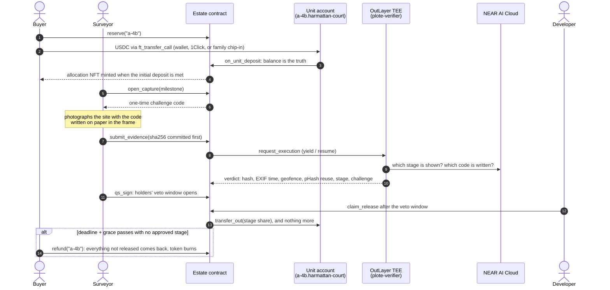
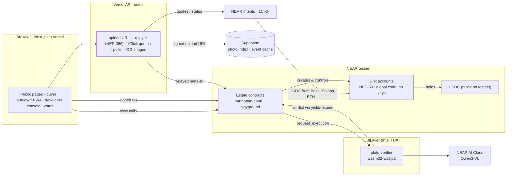

<div align="center">

# Plote

### Pay for the house you can see.

**Off-plan escrow on NEAR, where every housing unit is its own account and the NFT is the key to it.**

[](#why-this-is-an-nft-that-does-something)
[](#live-deployment)
[](LICENSE)

[**Live app**](https://plote-vert.vercel.app) · [**Build spec**](docs/SPEC.md) · [**Contract interface**](docs/INTERFACE.md) · [**Demo script**](docs/demo-script.md)

</div>

---

## The problem

Buying a flat "off-plan", before it is built, is how most new homes in Lagos and Abuja are sold. Buyers pay in instalments over 12 to 24 months, and three problems keep repeating:

| | What happens | Why it hurts |
|---|---|---|
| **Sold twice** | The same unit is sold to more than one buyer. | You find out at handover, years later. |
| **Paid up front, built never** | Instalments go straight to the developer's account. | When a project stalls, the money is already spent. |
| **Photos from far away** | Diaspora buyers, who drive a large share of sales, judge progress from WhatsApp pictures. | Those photos can be from anywhere, or from last year. |

Sources: [TechEconomy](https://techeconomy.ng/?p=164669) · [Nigeria Housing Market](https://www.nigeriahousingmarket.com/news/20-real-estate-scams-nigerian-property-buyers-must-avoid) · [allAfrica](https://allafrica.com/stories/202601290263.html) · [Guardian Nigeria](https://guardian.ng/property/diasporan-investors-drive-growth-expose-fault-lines-in-real-estate-sector/) · [Nation (Kenya)](https://nation.africa/kenya/news/off-plan-scams-from-dream-homes-to-dust--5347430)

## The solution

Plote gives **every off-plan unit its own NEAR account**, for example `a-4b.harmattan-court.plote.testnet`.

- **The buyer pays the unit, not the developer.** The USDC sits in the unit's account, which has no keys and obeys only its estate contract.
- **Money moves only on proof.** Each construction stage releases its share (20 / 30 / 30 / 20 %) only after a site photo passes checks inside secure hardware and a quantity surveyor signs.
- **If the build stalls, the buyer takes the money back.** After a missed deadline, whoever holds the unit's token pulls back everything not yet released. Nobody has to approve it.
- **Anyone can check any unit in seconds.** Type a unit name into `/check` to see who holds it, what has been paid, what has been released and what has been proven. No login.

> Demo estates (Harmattan Court, Baobab Heights, Plote Playground) and every person in them are fictional.

---

## Contents

- [Why this is an NFT that does something](#why-this-is-an-nft-that-does-something)
- [How it works](#how-it-works)
- [Architecture](#architecture)
- [Live deployment](#live-deployment)
- [Try it](#try-it)
- [Security model](#security-model)
- [Repository layout](#repository-layout)
- [Run it yourself](#run-it-yourself)
- [Testing and quality](#testing-and-quality)
- [Tech stack](#tech-stack)
- [Spec conformance](#spec-conformance)
- [Honest limits](#honest-limits)
- [Roadmap](#roadmap)
- [Licence and credits](#licence-and-credits)

---

## Why this is an NFT that does something

The allocation NFT (NEP-171 / 177 / 178 / 181) **is not a picture of a house. It is the right to one unit's account.** Its token ID is the unit ID, so each unit can only ever have one token, and a second sale of the same unit fails with `E_UNIT_TAKEN`. Every right below is enforced by the contract against whoever holds the token:

| The token… | Enforced by |
|---|---|
| **Holds the money.** Payments sit in the unit's own account until a stage is proven. | Unit account + `on_unit_deposit` |
| **Pulls a refund.** After a deadline plus grace with no approved stage, the holder takes back everything not released. | `refund(unit_id)`, holder only |
| **Sells in one step.** The buyer's USDC and the token swap in a single transaction, and the escrow stays with the unit. | `list_for_sale` → `ft_transfer_call` |
| **Protects you if you fall behind.** Missed instalments list the unit for what you paid, minus a fixed 5 %. Nothing is forfeited. | `declare_default` |
| **Votes.** One vote per unit, to replace the surveyor, veto a sign-off, freeze releases or extend a deadline. Tokens bought after a vote opens can't swing it. | `propose` / `vote` |
| **Opens the gate.** After handover, the holder signs a gate pass that the guard's phone checks against the chain. | NEP-413 signed message |

The token's **image is drawn by the contract** from the unit's live state on every view. Each proven stage fills in, and the windows turn gold at handover, so the NFT always shows what it's worth.

---

## How it works



**The core rule is that the unit's balance is the truth.** Money can arrive by wallet, as a cross-chain delivery through NEAR Intents, or from a relative. The estate re-reads the unit's USDC balance and credits the difference. Wallet payments to an unreserved unit bounce straight back, and stray deposits are never credited to anyone.

---

## Architecture



| Component | Path | Role |
|---|---|---|
| **Estate contract** | `contracts/estate` | Units, allocation NFT, milestones, evidence and verdicts, releases, refunds, resale, default, holder votes, dynamic NFT image. |
| **Unit contract** | `contracts/unit` | Runs on every unit account, published once as a NEP-591 global contract. Holds the USDC, has no keys, and obeys only its estate. |
| **Mock USDC** | `contracts/musdc` | NEP-141 test token with an open faucet (testnet only). |
| **Verifier** | `verifier/` | OutLayer TEE worker: SHA-256 integrity, EXIF freshness, GPS geofence, perceptual-hash reuse, screen-photo detection, and NEAR AI stage plus challenge-code reading. |
| **Web app** | `web/` | Next.js App Router: public check, estates, units, proofs, the buyer flow, the surveyor PWA, the developer console, votes and the API routes. |
| **Scripts** | `scripts/` | Deploy and demo tooling, including wallet-free OutLayer setup (`outlayer-setup.ts`). |
| **Off-chain cache** | `supabase/` | Photo index, event feed cache, 1Click quotes, chip-ins. The chain stays the source of truth. |

---

## Live deployment

**App:** https://plote-vert.vercel.app · health: [`/api/health`](https://plote-vert.vercel.app/api/health)

| Piece | Account / location | Status |
|---|---|---|
| Judge sandbox estate | [`playground.plote.testnet`](https://testnet.nearblocks.io/address/playground.plote.testnet), 60 units at $1,000 | ✅ Live |
| Demo estate | [`harmattan-court.plote.testnet`](https://testnet.nearblocks.io/address/harmattan-court.plote.testnet), 6 units | ✅ Live |
| Refund-demo estate | [`baobab-heights.plote.testnet`](https://testnet.nearblocks.io/address/baobab-heights.plote.testnet), 5 units, foundation deadline missed | ✅ Live (judge holds `b-2a`, `b-2b` with refunds open) |
| Estate code (all three estates) | sha256 `158ce0ab0b7f4fbf4372c011d9f39433af28ff49c9f3d459d2c1baad76230c26` · NEAR `code_hash` `2T89xpkpUq3M44Jq2QKkXgAkNQw6caVUaU5V7Le9w8Qd` | ✅ Compare with `view_account` |
| Unit code (global, by hash) | `75ddgBuGJQYJKgjiBkvZ6FVsMnGFfJvtYCrs3A6aFxb9` (105,621 B) | ✅ Published |
| Test USDC | [`musdc.plote.testnet`](https://testnet.nearblocks.io/address/musdc.plote.testnet) | ✅ Live |
| Verifier project | `plote.testnet/plote-verifier` on `outlayer.testnet` | ✅ Published |
| Verifier version (pinned on-chain) | `31c7225df81449c11bac1ae31b00fbfcc353a64a2f1aed4b0ce9c90e1dd818f8` | ✅ All estates pinned |
| Verifier secrets access | `Predecessor(Whitelist[estate])`: only runs requested by the estate contract itself can use its NEAR AI key | ✅ Playground, Harmattan Court |
| Verifier binary | [FastFS](https://test.fastfs.io/plote.testnet/outlayer.testnet/31c7225df81449c11bac1ae31b00fbfcc353a64a2f1aed4b0ce9c90e1dd818f8.wasm) (anyone can re-hash it) | ✅ |
| Off-chain cache | Supabase (7 tables, row-level security, `evidence` bucket) | ✅ Live |
| Gasless relayer | `relayer.plote.testnet` | ✅ Live |
| Live photo checks | Full pipeline verified live (browser capture → relayer → upload → on-chain commit → OutLayer TEE → verdict); stage and code reading need NEAR AI credits | ⏳ Waiting on NEAR AI credits for the API key |
| Mainnet any-chain payment (≈ $2) | One unit receiving USDC through 1Click | ⏳ Pending |

Every number on the live site is read from the chain. Until a figure exists it shows "—" rather than a made-up value.

---

## Try it

**No install, NEAR testnet.** Use any NEAR testnet wallet (Meteor, MyNearWallet, HOT, Intear and others).

1. **Check a unit.** Open [`/check`](https://plote-vert.vercel.app/check) and type `a-4b.harmattan-court` or `p-07.playground` to see the holder, payments, releases and status.
2. **Get test money.** Connect a wallet, open [`/faucet`](https://plote-vert.vercel.app/faucet) and mint 5,000 test USDC.
3. **Buy a unit.** In the [Plote Playground](https://plote-vert.vercel.app/estates/playground), pick any available unit (`p-01`…`p-60`), **Reserve**, then **Pay** at least 10 %. The allocation NFT mints to you; `/me` shows it, and the unit account's balance is on NearBlocks.
4. **Prove a stage** (the playground lets any wallet act as surveyor):
   1. Choose **Capture** and write the 6-character code on paper.
   2. Photograph it anywhere, then watch the TEE verdict land on-chain.
   3. Choose **Sign**, wait for the 2-minute veto window, then **Claim**.

   20 % of each unit's paid amount moves to the developer, and not a cent more.
5. **Read a proof.** `/proof/<estate>/<id>` shows every check, the photo, the model's observations, the pinned worker version and the raw verdict.
6. **Refund** (Baobab Heights, once deployed): units past their deadline show **Get my money back**. One tap and everything not released returns to the holder.

The full narrated flow is in [`docs/demo-script.md`](docs/demo-script.md). Shared judge-wallet credentials are provided with the submission, not in this repository.

---

## Security model

| Boundary | Guarantee | How |
|---|---|---|
| **Funds** | Only the estate's public rules can move USDC. | Unit accounts are created with no access keys; `transfer_out` accepts calls from the estate only (`E_NOT_ESTATE`). |
| **One unit, one owner** | A unit can't be sold twice. | Token ID = unit ID; a second mint panics with `E_UNIT_TAKEN`. |
| **Photo integrity** | The checked photo is the uploaded photo. | Its SHA-256 is committed on-chain *before* the verifier runs. |
| **Verdict provenance** | Verdicts come only from the attested worker. | Estates in `outlayer` mode reject relayer verdicts (`E_VERIFY_MODE`). Estates are pinned to a verifier version, and GitHub-sourced builds must match `worker_commit`. |
| **Freshness** | The photo was taken after the capture opened. | A one-time challenge code must be readable in the frame. This check fails hard in every mode. |
| **Surveyor power** | The surveyor can't move money. | Their scoped key can only call milestone methods. Holders can veto a sign-off or vote the surveyor out. |
| **Relayer** | The relayer only pays gas. | An allowlist of methods and receivers, a zero deposit and a gas cap. |
| **Secrets** | The NEAR AI key is usable only by Plote's estates. | ECIES-encrypted to the OutLayer keystore, stored per estate and whitelisted to that estate account. |

### Verifier checks, in order (fail fast)

| # | Check | Fails when (reason code) | Playground |
|---|---|---|---|
| 1 | Integrity | the photo can't be fetched (`fetch_failed`), or its SHA-256 ≠ the hash committed on-chain (`hash_mismatch`) | fail |
| 2 | Decode | the image is unreadable or unusable (`bad_image`) | fail |
| 3 | Freshness | EXIF time is missing, in the future or too old (`exif_missing`, `exif_future`, `exif_stale`) | fail |
| 4 | Location | GPS is missing or outside the geofence (`gps_missing`, `outside_geofence`) | skipped (no geofence) |
| 5 | Reuse | the perceptual hash is too close to an earlier photo | fail |
| 6 | Stage (NEAR AI) | it's a photo of a screen (`ai_screen_photo`); the AI sees a different stage or is unsure (`ai_stage_mismatch`, `ai_low_confidence`); the AI is unreachable (`ai_unavailable`) | screen photo fails; stage → warning; outage → warning in demo mode |
| 7 | Challenge | the written code is unreadable, missing or wrong, or the photo predates the capture (`challenge_unverified`, `challenge_missing`, `challenge_mismatch`, `exif_before_capture`) | **fail, always** |

Panics use stable `E_*` codes ([INTERFACE §1.5](docs/INTERFACE.md)) that the app maps to plain-English messages ([`web/lib/errors.ts`](web/lib/errors.ts)).

---

## Repository layout

```
contracts/
  estate/            estate contract (near-sdk 5.29.1) and its unit tests (tests.rs)
  unit/              unit-account contract, published as a NEP-591 global contract
  musdc/             testnet USDC with an open faucet
  mocks/outlayer-mock/   canned verdicts for offline runs (marked "mock_verifier")
verifier/            OutLayer TEE worker (Rust, wasm32-wasip2) and fixtures
web/                 Next.js 16 app: pages, components, API routes, Vitest + Playwright tests
scripts/             near-api-js deploy and demo scripts, outlayer-setup.ts
config/              estate configs (pinned verifier, deadlines, units) and deployments.testnet.json
supabase/migrations/ off-chain cache schema with row-level security
tests/integration/   near-mock tests that run the real contract WASMs together
docs/                SPEC.md (design) · INTERFACE.md (exact JSON interface) · demo-script.md · hosting.md
```

---

## Run it yourself

### Prerequisites

- Rust stable with `wasm32-unknown-unknown` and `wasm32-wasip2`, plus `cargo-near` 0.22
- Node 22 and pnpm 10
- `just`
- A funded NEAR testnet account (see the budget below)

### Build and test

```bash
git clone https://github.com/linoxbt/Plote && cd Plote
just test          # contracts, web unit tests and verifier
just build         # contract WASMs into target/near/
just lint          # fmt, clippy -D warnings, eslint, typecheck
just test-integration
```

### Deploy to testnet

```bash
pnpm -C scripts install
# Put the root account key in ~/.near-credentials/testnet/plote.testnet.json (never in the repo)
just accounts      # developer, surveyor, relayer, buyers and judge accounts
just deploy-testnet
cd verifier && cargo build --release --target wasm32-wasip2 && cd ..
NEAR_AI_API_KEY=… pnpm -C scripts exec tsx outlayer-setup.ts   # publish, store secret, pin estates
just seed          # demo purchases and proofs (see docs/SPEC.md §13.9)
```

`outlayer-setup.ts` needs no wallet or dashboard. It does what the official `outlayer-cli` does:
1. Uploads the verifier to FastFS.
2. Creates the OutLayer project.
3. Encrypts the NEAR AI key to the OutLayer keystore and stores it for each estate.
4. Pins each estate to the version key, which is the SHA-256 of the WASM.

### NEAR budget (measured on testnet)

| Item | Cost |
|---|---|
| Unit code published once as a global contract (105.6 KB; global deploys burn 10 NEAR per 100 KB) | **10.56 NEAR, burned** |
| Each estate account (573 KB contract ≈ 5.7 NEAR of storage, plus headroom) | 7 NEAR |
| Verification budget per estate (0.05 NEAR per photo check) | 2 NEAR |
| Units | 0.035 NEAR each |
| Role accounts (developer, surveyor, relayer, 4 buyers, judge) | 16.5 NEAR |
| Mock USDC | 2.5 NEAR |
| OutLayer project and each estate's secret | 0.1 NEAR each |

All three estates with seed data come to about 70 testnet NEAR.

### Web app

```bash
cp web/.env.example web/.env.local
just web
```

| Variable | Where | Purpose |
|---|---|---|
| `NEXT_PUBLIC_NETWORK`, `NEXT_PUBLIC_RPC_URL`, `NEXT_PUBLIC_ESTATES`, `NEXT_PUBLIC_USDC_ID` … | public | network, RPC, estates shown, token |
| `NEXT_PUBLIC_SUPABASE_URL`, `NEXT_PUBLIC_SUPABASE_ANON_KEY` | public | read-only cache (row-level security allows select on public tables only) |
| `SUPABASE_SERVICE_ROLE_KEY` | **server only** | signed photo upload URLs, poller writes |
| `RELAYER_ACCOUNT_ID`, `RELAYER_PRIVATE_KEY` | **server only** | gasless meta-transactions (NEP-366) |
| `CRON_SECRET` | **server only** | protects the 5-minute poller endpoint |
| `ONECLICK_JWT`, `RESEND_API_KEY` | server, optional | removes the 1Click fee; milestone emails |

Every variable has a testnet default, so the app builds and renders with no env at all. A feature that needs a missing secret returns a clear 503. Hosting notes are in [`docs/hosting.md`](docs/hosting.md).

---

## Testing and quality

| Layer | What's covered | Result |
|---|---|---|
| Estate contract | 60 unit tests, including the spec's invariants: no double mint, money conservation over a randomised 200-step walk, release cap against approved stages, exits only to allowed accounts, evidence committed before the check, verdict-mode and verifier-pin enforcement | ✅ pass |
| Unit and mock USDC contracts | 5 + 3 tests | ✅ pass |
| Real WASMs together | `just test-integration` (near-mock with real receipts and metered gas): unit creation, buy → allocate, capture → evidence → verdict → sign → 20 % release, reused-photo failure, freeze vote, resale, refund + burn | ✅ 5/5 |
| Verifier | 74 library tests + 4 that run the binary; challenge-is-hard in every mode; prompt-injection, orientation-reuse and timeout cases | ✅ pass |
| Web | typecheck, lint, 77 Vitest tests (incl. relayer signature checks), production build | ✅ pass |
| End-to-end | 14 Playwright tests on mobile and desktop against the production build | ✅ pass |
| Live on testnet (10 Nov) | Real transactions against the deployed contracts and the live site: buy (mint → reserve → pay → NFT), photo capture through the browser phone key and relayer into the OutLayer TEE, resale in one transaction, holder vote, refund + burn, API guards. Scripts in `scripts/e2e/` | ✅ pass (a passing photo needs NEAR AI credits) |
| Static analysis | `cargo clippy -D warnings`, `cargo fmt --check` | ✅ clean |
| Security | Internal pre-audit review of contracts, verifier and server; findings and fixes in [`docs/SECURITY-REVIEW.md`](docs/SECURITY-REVIEW.md). Launch gates in [`docs/LAUNCH.md`](docs/LAUNCH.md) | ✅ fixed / ⏳ independent audit |

The repository's definition of done, which every change in the history passed:

```bash
cargo test --workspace && cargo clippy --workspace --all-targets -- -D warnings && pnpm -C web typecheck && pnpm -C web test
```

---

## Tech stack

| Layer | Technology |
|---|---|
| Contracts | Rust, near-sdk 5.29.1, NEP-171/177/178/181 (NFT), NEP-141/145 (USDC), NEP-591 global contracts, NEP-297 events |
| Verification | OutLayer (Intel TDX TEE, yield/resume), NEAR AI Cloud (Qwen/Qwen3-VL-30B-A3B-Instruct), wasm32-wasip2 |
| Payments | NEAR wallets, NEAR Intents 1Click API (USDC/USDT from Base, Arbitrum, Ethereum, Solana, BNB, Polygon) |
| Identity | @hot-labs/near-connect, function-call keys, NEP-366 meta-transactions, NEP-413 signed messages |
| Web | Next.js 16 (App Router), React 19, Tailwind CSS v4, TanStack Query, near-api-js 7 |
| Data | Supabase (Postgres + Storage, row-level security) |
| Quality | cargo test, near-mock integration tests, Vitest, Playwright, GitHub Actions |

---

## Spec conformance

The build follows [`docs/SPEC.md`](docs/SPEC.md); [`docs/INTERFACE.md`](docs/INTERFACE.md) is authoritative on names and types. A full spec-versus-code audit was run, and every finding was fixed except these known, deliberate deviations:

- **Estate WASM size:** 573 KB against a target of about 400 KB, with every size optimisation applied. Meeting the target would mean restructuring the contract. The only cost is storage (about 5.7 NEAR per estate).
- **AI outages fail checks:** the challenge code must be read by the AI and fails hard (§6.1). As a result, a NEAR AI outage fails verdicts even in demo mode, which favours integrity over demo resilience.
- **"Could" items C8 and C9** (vanity unit names, the service-charge screen) are not built, per the spec's scope rule.

---

## Honest limits

- **Plote is not a land title.** It proves allocation and payment, not legal ownership. Always check the C of O or governor's consent with a lawyer.
- **A fraudulent developer simply won't opt in.** Plote is for honest developers who want to prove it, and "our escrow is public" is the sales pitch.
- **The TEE proves the published checks ran on the committed photo, not that the scene is honest.** EXIF can be forged. The challenge code rules out photos taken before the capture opened, and a replaceable surveyor still signs.
- **GPS may come from the device** when the photo has none. The proof page says which source was used.
- **Testnet first.** The escrow logic runs on testnet; mainnet demonstrates the cross-chain payment rail.
- **USDC today.** Naira on-ramps are on the roadmap, not in this build.

---

## Roadmap

- Naira on-ramp partners for local buyers
- QR code on the paper allocation letter, linking to the on-chain unit
- Optional, opt-in yield on idle escrow
- Co-buying a unit with siblings (multi-owner token)
- Integration with state land registries

---

## Licence and credits

[MIT](LICENSE) © 2026 Lino.

Built during the NEAR HACKATHON (Nov 1–14 2026); the commit history shows the work. Third-party building blocks include [near-sdk](https://github.com/near/near-sdk-rs), near-contract-standards, [OutLayer](https://outlayer.fastnear.com), [NEAR AI Cloud](https://near.ai), the [NEAR Intents 1Click API](https://docs.near-intents.org), near-connect and [Supabase](https://supabase.com).

<div align="center"><sub>Plote: every off-plan home, its own account.</sub></div>
